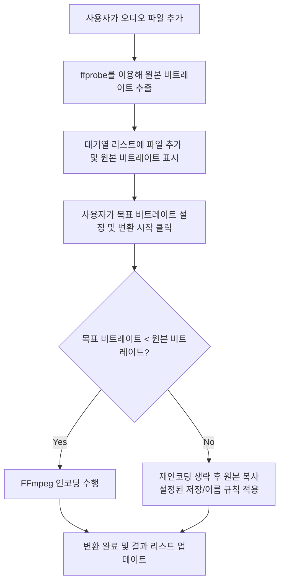

# Audio Bitrate Converter (오디오 비트레이트 변환기)

이 프로젝트는 대용량 고음질 MP3 파일의 비트전송률(Bitrate)을 원본보다 낮추어 용량을 줄이고, 오프라인 휴대 기기(MP3 플레이어 등)에 최적화된 상태로 변환해 주는 윈도우 데스크톱 GUI 프로그램입니다. 

기존 `youtube_down` 프로그램의 개발 패턴과 디자인 톤앤매너를 유지하여, 사용자에게 일관성 있고 프리미엄한 사용 경험을 제공합니다.

---

## 📌 기획 배경 및 요구사항

### 1. 기획 의도
* **비트레이트 하향 변환의 당위성**: 오디오 파일의 비트레이트를 원본보다 높이는 변환(예: 128kbps -> 320kbps)은 물리적으로 손실된 음질을 복구하지 못하며 용량만 불필요하게 늘어납니다. 따라서 **"오디오 비트레이트는 항상 원본 이하로만 변환할 수 있어야 한다"**는 핵심 규칙을 프로그램 레벨에서 강제하여 오동작 및 무의미한 연산을 방지합니다.
* **편의성**: 수십~수백 개의 MP3 파일을 마우스 드래그 앤 드롭으로 대기열에 한 번에 담아 일괄(배치) 변환할 수 있도록 지원합니다.

### 2. 핵심 기능 요구사항
* **다양한 입력 방식 지원**:
  * **파일 개별 추가**: 단일 또는 다중 MP3 파일을 직접 탐색기에서 드래그 앤 드롭하거나 파일 선택 창을 통해 가져옵니다.
  * **폴더 단위 추가**: 폴더 자체를 드래그 앤 드롭하거나 폴더 선택 창으로 지정하면, 해당 폴더 내의 모든 MP3 파일을 자동으로 탐색하여 대기열에 일괄 추가합니다.
* **원본 비트레이트 감지**: 파일을 추가하면 백그라운드에서 오디오 파일 정보를 탐색하여 원본의 정확한 비트레이트 값을 실시간으로 파악합니다.
* **비트레이트 비교 및 필터링 (상한선 제한)**:
  * 유저가 설정한 목표 비트레이트(예: 192kbps)가 원본 비트레이트보다 낮은 파일만 실제 인코딩 작업을 수행합니다.
  * 목표 비트레이트가 원본과 같거나 더 높은 경우, 무의미한 재인코딩을 수행하지 않고 **'복사(음질 유지)'** 상태로 분류합니다. 이 경우 비트레이트 수정 없이, 유저가 설정한 **저장 위치 및 파일명 처리 옵션을 그대로 적용하여 원본 파일을 복사 생성**합니다.
* **일괄 변환 (Batch Processing)**: 백그라운드 스레드에서 대기열에 쌓인 다수의 파일을 차례대로 변환하며, UI는 멈추지 않고 실시간 진행 상황을 계속 반영합니다.
* **다양한 저장 및 파일명 처리 옵션**:
  * **저장 위치 지정**: 
    * `원본 파일과 동일한 폴더에 저장` (소스 폴더 기반)
    * `특정 출력 폴더 지정` (사용자가 선택한 특정 경로에 일괄 저장)
  * **파일명 패턴 옵션**:
    * `덮어쓰기 (Overwrite)`: 원본 파일을 변환된 파일로 완전히 대체합니다. (원본 경로와 저장 경로가 같을 때 덮어쓰기 여부를 묻는 경고 팝업 제공)
    * `접미사(Suffix) 추가`: 파일명 끝에 붙임 (예: `Dynamite_192k.mp3`)
    * `접두사(Prefix) 추가`: 파일명 앞에 붙임 (예: `[192k]_Dynamite.mp3`)

---

## 🛠️ 기술 스택 및 라이브러리 구성

* **Language**: Python 3.8+
* **GUI Framework**: CustomTkinter
  * `youtube_down`과 동일한 모던 다크 테마 GUI 프레임워크를 사용하여 세련된 비주얼을 제공합니다.
* **Multimedia Engine**: FFmpeg / FFprobe
  * 오디오 분석(`ffprobe`) 및 인코딩(`ffmpeg`)을 위해 시스템에 설치된 바이너리를 활용하거나, 독립 포터블 실행 파일 내에 내장할 수 있도록 설계합니다.
* **Core Libraries**:
  * `subprocess` (FFmpeg 명령 실행)
  * `json` (FFprobe 메타데이터 출력 파싱)
  * `threading` (UI 프리징 방지를 위한 멀티스레딩 처리)
  * `TkinterDnD2` (파일 드래그 앤 드롭 입력을 간편하게 처리하기 위한 확장 라이브러리)

---

## 🔄 핵심 알고리즘 흐름도



### 1. 비트레이트 정보 추출 예시 (FFprobe 사용)
```bash
ffprobe -v error -select_streams a:0 -show_entries stream=bit_rate -of default=noprint_wrappers=1:nocey=1 input.mp3
```
위 명령어를 Python `subprocess`로 호출하여 원본 오디오의 비트레이트(bps) 값을 정수형식으로 읽어와 판별합니다. (예: `320000` -> 320kbps)

### 2. 인코딩 예시 (FFmpeg 사용)
```bash
ffmpeg -y -i input.mp3 -codec:a libmp3lame -b:a 192k output.mp3
```
목표 비트레이트 매개변수 `-b:a`를 유저가 설정한 값으로 입력하여 재인코딩을 수행합니다.

---

## 🎨 GUI 시안 구성

`youtube_down` 앱의 깔끔한 컴포넌트 구성을 모티브로 한 세련된 레이아웃 설계안입니다.

```
+-----------------------------------------------------------------------+
|  Audio Bitrate Converter v1.0.0                                  [X]  |
+-----------------------------------------------------------------------+
|  [ 드래그 앤 드롭 영역: 파일 또는 폴더를 여기에 끌어다 놓으세요 ]      |
|                                                                       |
|                     [파일 추가...]    [폴더 추가...]                  |
+-----------------------------------------------------------------------+
|  목표 비트레이트: [ 192 kbps (추천)  v ]                               |
|                                                                       |
|  저장 위치 설정:                                                      |
|   (o) 원본 파일과 동일한 폴더에 저장                                 |
|   ( ) 특정 지정 폴더에 저장 -> 경로: [ C:\Output_Audio         ] [변경] |
|                                                                       |
|  파일명 처리 옵션:                                                     |
|   ( ) 원본 파일 덮어쓰기 (기본 파일 대체)                             |
|   (o) 접미사 추가 -> 형식: 파일명 + [ _192k          ] + .mp3         |
|   ( ) 접두사 추가 -> 형식: [ [192k]_         ] + 파일명 + .mp3         |
+-----------------------------------------------------------------------+
|  [ 대기열 목록 ]                                                       |
|  파일명                 | 원본 비트레이트 | 목표 비트레이트 | 상태    |
|  -------------------------------------------------------------------  |
|  01. Dynamite.mp3       | 320 kbps        | 192 kbps        | 대기    |
|  02. Love Lee.mp3       | 128 kbps        | 192 kbps        | 복사(유지) |
|  03. Hype Boy.mp3       | 256 kbps        | 192 kbps        | 변환완료|
+-----------------------------------------------------------------------+
|  진행률: [=======================>                     ] 45% (1/2)    |
|                                               [변환 시작] [대기열 비우기] |
+-----------------------------------------------------------------------+
```

### UI 디자인 주요 포인트:
1. **드래그 앤 드롭 & 파일/폴더 선택 지원**:
   * 마우스 드래그 앤 드롭 영역에 파일 또는 폴더를 떨어뜨려 추가 가능.
   * `[파일 추가...]` 및 `[폴더 추가...]` 버튼을 별도로 두어 탐색기 창을 통해서도 편리하게 가져올 수 있도록 지원.
2. **다양한 저장 및 파일명 옵션 배치**:
   * 라디오 버튼 그룹을 통해 원본 위치 저장과 지정 위치 저장을 직관적으로 토글 선택.
   * 파일명 변환 방식(덮어쓰기, 접미사, 접두사)을 선택하고 원하는 문자열 서식을 텍스트 박스로 직접 입력 가능하게 구성.
3. **상태 표시 아이콘/라벨**: 
   * **복사(유지)**: 원본 비트레이트가 목표 비트레이트보다 낮아 재인코딩은 건너뛰는 상태입니다. 비트레이트 변환은 하지 않되, 사용자가 설정한 파일명 옵션 및 저장 폴더 규칙에 맞추어 원본 파일을 그대로 복사 생성합니다.
   * **대기 / 변환중 / 완료**: 실시간 상태를 텍스트 및 프로그레스바로 피드백합니다.

---

## 🚀 향후 개발 로드맵

1. **Phase 1: CLI 프로토타입 구현**
   * Python 가상환경 구성
   * `ffmpeg` / `ffprobe` 실행 테스트 및 비트레이트 판별 로직 검증 코드 작성
2. **Phase 2: GUI 및 스레드 설계**
   * CustomTkinter 구조화 및 창 레이아웃 구현
   * 멀티 파일 드래그앤드롭 이벤트 바인딩
   * 백그라운드 인코딩 작업을 위한 `Queue` 및 `Thread` 구조 구축
3. **Phase 3: 예외 처리 및 폴리싱**
   * 파일 포맷 유효성 체크 (MP3 이외 파일 차단)
   * 변환 실패 시 에러 로그 출력 및 재시도 기능
4. **Phase 4: EXE 빌드 및 배포**
   * `pyinstaller` 설정 파일(`audio_converter.spec`)을 통해 FFmpeg 바이너리 포함 빌드 여부 결정 및 단일 배포용 EXE 추출
